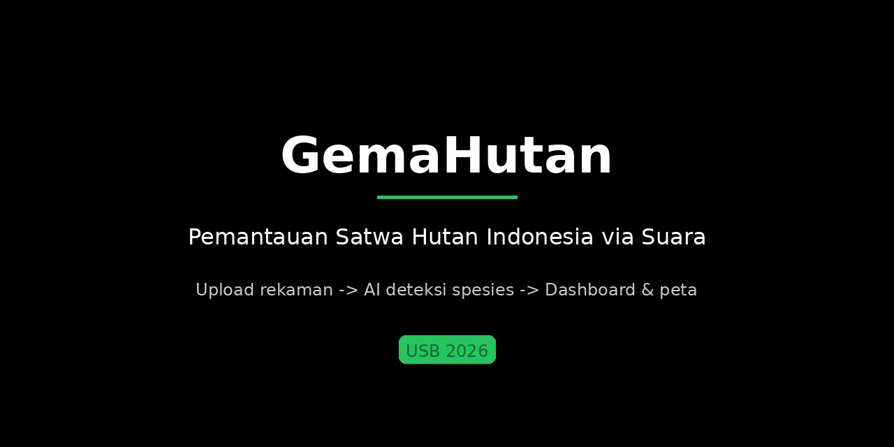

# GemaHutan




Passive Acoustic Monitoring (PAM) platform for tropical forest biodiversity in Indonesia. GemaHutan records forest soundscapes, identifies 25 priority Indonesian bird species using BirdNET embeddings and local classifiers, calculates ecoacoustic soundscape indices, and maps verified detections for conservation rangers and researchers.

Live Platform: [gemahutan.site](https://gemahutan.site)

## Architecture

```text
+-------------------------------------------------------------------------+
| Field Acoustic Recorders / Ranger Upload                                |
|   - Audio files (WAV, MP3, FLAC, OGG) from forest monitoring stations   |
+------------------------------------|------------------------------------+
                                     |
                                     v
+-------------------------------------------------------------------------+
| GemaHutan Processing Engine (FastAPI + Redis + ARQ Worker)              |
|                                                                         |
|  [Audio Preprocessing]   : 48 kHz mono resampling, 3-second segments    |
|         |                                                               |
|         +-----------------------+-----------------------+               |
|         v                                               v               |
|  [Species Classification]                      [Soundscape Indices]     |
|   - Track A: BirdNET-Analyzer v2.4 (zero-shot)  - ACI, NDSI, ADI, BI    |
|   - Track B: Custom classifier (25 Indo birds)    via scikit-maad       |
|         |                                               |               |
|         +-----------------------+-----------------------+               |
|                                 v                                       |
|  [Storage & Spatial Index]: PostgreSQL 16 + PostGIS 3.4 & MinIO S3      |
+---------------------------------|---------------------------------------+
                                  |
                                  v
+-------------------------------------------------------------------------+
| Conservation Web Portal (Next.js 15 + Tailwind CSS 4 + daisyUI 5)       |
|   - Interactive detection map with geospatial clustering                |
|   - Audio player with synchronized bioacoustic spectrograms             |
|   - Expert verification workflow and model fine-tuning feedback loop    |
|   - Role-based access: Admin, Researcher, Field Ranger                  |
+-------------------------------------------------------------------------+
```

## Key Capabilities

- Dual-track bioacoustic inference: global BirdNET zero-shot combined with a calibrated local classifier trained on 25 priority Indonesian forest bird species.
- Soundscape ecology analytics: automated calculation of Acoustic Complexity Index (ACI), Normalized Difference Soundscape Index (NDSI), Acoustic Diversity Index (ADI), and Bioacoustic Index (BI) using `scikit-maad`.
- Spatial intelligence: PostGIS-powered geospatial query engine mapping acoustic observations, detection confidence, and recorder coordinates.
- Expert verification loop: field biologists can inspect spectrograms, confirm or reject model detections, and feed validated data back into retraining.
- Instant public demo: guest upload mode with automatic 24-hour sandbox lifecycle cleanup, plus dedicated role portals for staff.

## Technology Stack

| Layer | Technologies |
| --- | --- |
| Frontend | Next.js 15 (App Router), TypeScript 5, Tailwind CSS 4, daisyUI 5 |
| Backend API | FastAPI, Python 3.11, Pydantic v2 |
| Task Queue & Workers | Redis 7, ARQ asynchronous worker daemon |
| Database & GIS | PostgreSQL 16, PostGIS 3.4 spatial extensions |
| Object Storage | MinIO (S3-compatible object storage) |
| Machine Learning | BirdNET-Analyzer v2.4, custom embedding classifier |
| Bioacoustics | scikit-maad 1.5, librosa, soundfile |
| Containerization | Docker, Docker Compose |

## Model Performance

Evaluation metrics on nested cross-validation and independent test splits (official figures from `ml/reports/angka_resmi.json`):

| Evaluation Metric | Score | Notes |
| --- | --- | --- |
| Macro F1 (Nested CV) | 0.729 | 95% Confidence Interval: [0.690, 0.751] |
| Independent Accuracy | 0.756 | Evaluated against 131 independent foreign test clips |
| Independent F1 | 0.607 | Macro F1 on out-of-domain benchmark |
| End-to-End Precision | 0.677 | Combined detection pipeline precision |
| End-to-End Recall | 0.729 | Combined detection pipeline recall |

## Quick Start

### Local Deployment via Docker Compose

```bash
git clone git@github.com:azrahudaya/gemahutan-app.git
cd gemahutan-app
cp .env.example .env
docker compose up -d
```

Open `http://localhost:3001` in your browser. All services (API, worker, web interface, PostgreSQL/PostGIS, Redis, and MinIO storage) spin up automatically.

## Documentation Index

- [`ARCHITECTURE.md`](docs/ARCHITECTURE.md): Service architecture, data schemas, and pipeline specifications.
- [`API.md`](docs/API.md): Full REST API contract and endpoint documentation.
- [`MANUAL.md`](docs/MANUAL.md): User guide for rangers, researchers, and administrators.
- [`DEPLOY.md`](docs/DEPLOY.md): Production deployment guide and environment configuration.
- [`DECISIONS.md`](docs/DECISIONS.md): Architectural decision records (ADR).
- [`VISI_DAN_RUANG_LINGKUP.md`](docs/VISI_DAN_RUANG_LINGKUP.md): Vision, user personas, and project roadmap.
- [`LICENSES.md`](docs/LICENSES.md): Third-party licenses and bioacoustic model attribution.

## Competition & Team

Developed for **USB 2026** (Software Development Category), Universitas Gunadarma.

- **Artya Epriliani** (NPM: 10124205): Team Lead, Information Systems
- **Azra Hudaya** (NPM: 50423244): Technical Lead, Informatics

## License

Source code is released under the [MIT License](LICENSE). Third-party dependencies and model licenses are listed in [`docs/LICENSES.md`](docs/LICENSES.md). BirdNET-Analyzer is licensed under CC BY-NC-SA 4.0 for non-commercial research use.
